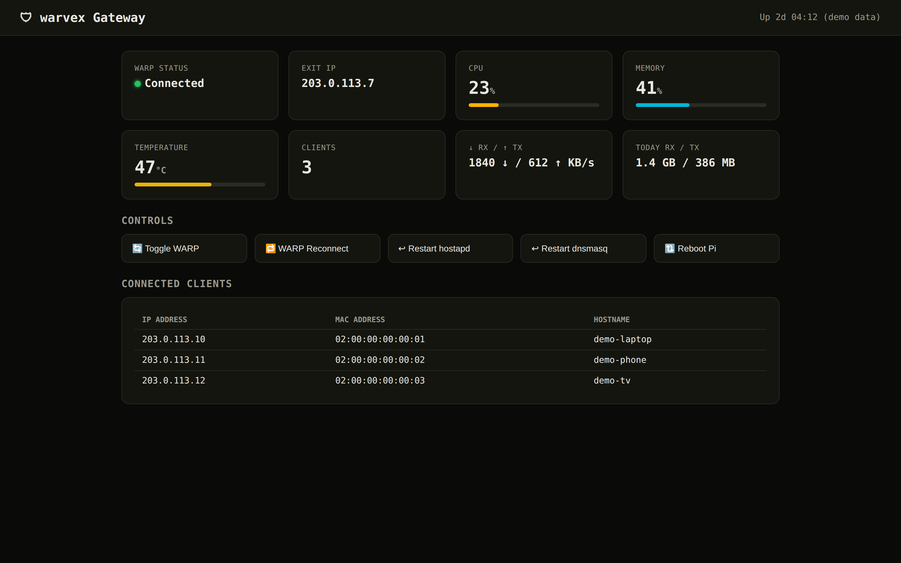
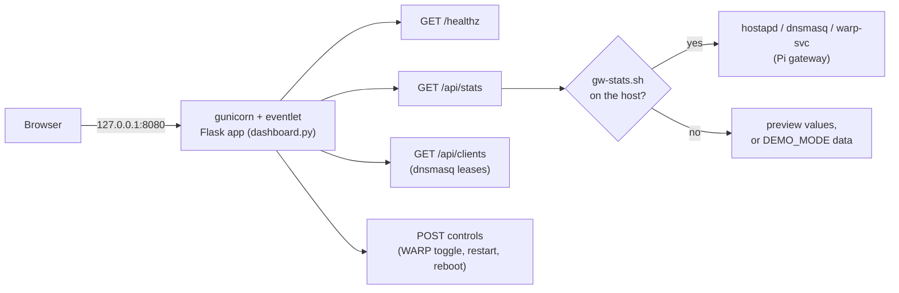

<div align="center">


# warvex

Self-hosted status dashboard for a Raspberry Pi Cloudflare WARP gateway.

[](https://github.com/OneByJorah/warvex/actions/workflows/ci.yml)
[](https://github.com/OneByJorah/warvex/releases)
[](LICENSE)
[](https://github.com/OneByJorah/warvex/actions/workflows/docker.yml)

> Formerly WarpGate.

</div>



The screenshot shows the dashboard in demo mode: fake data, documentation-range IP addresses, no real hosts.

## Why this exists

A Pi running as a WiFi gateway with its traffic routed through Cloudflare WARP has no built-in way to answer "is it up, and who is connected?". warvex is that answer: one small Flask app, one container, a dark dashboard with WARP state, the exit IP, system load, and the current client list, plus a few controls you would otherwise need SSH for.

It runs two ways: as a Docker container that previews the dashboard anywhere, or installed on the Pi itself where it reads live stats from the host.

## Features

- **Gateway status** — WARP tunnel state, exit IP, CPU, memory, temperature, throughput, and daily totals. On the Pi these come from `/usr/local/bin/gw-stats.sh`; without that script the app serves preview values and says so.
- **Connected clients** — the dnsmasq lease table (IP, MAC, hostname). Empty outside the Pi.
- **Controls** — toggle/reconnect WARP, restart `hostapd` or `dnsmasq`, reboot the Pi. Every control is a `POST`, restricted to the AP subnet, and allowed from localhost for development.
- **Health endpoint** — `GET /healthz` returns 200 for container healthchecks and orchestrators.
- **Demo mode** — `DEMO_MODE=true` serves seeded fake stats and clients for previews and screenshots.
- **Small footprint** — one Python file, one container image, runs as a non-root user, published on `127.0.0.1` only.

## Quick start

### Docker (recommended)

```bash
git clone https://github.com/OneByJorah/warvex.git
cd warvex
cp .env.example .env
docker compose up -d --build
```

Open <http://127.0.0.1:8080>. Verify:

```bash
curl -sf http://127.0.0.1:8080/healthz   # {"status":"ok"}
```

`docker compose up -d --build` builds the image locally and tags it `ghcr.io/onebyjorah/warvex:latest`. The same image is published to GHCR by the Docker workflow on pushes to `main`.

### From source

```bash
git clone https://github.com/OneByJorah/warvex.git
cd warvex
python3 -m venv .venv && . .venv/bin/activate
pip install .
warvex
```

Requires Python 3.11+. The `warvex` command starts the dashboard on `DASHBOARD_PORT` (default 8080).

### On a Raspberry Pi (full gateway)

The Pi installer turns a Raspberry Pi (Ubuntu/Debian arm64, WiFi AP capable, root required) into the WARP gateway itself: `hostapd` access point, `dnsmasq` DHCP, Cloudflare WARP routing, the dashboard, and an optional Telegram bot.

```bash
sudo bash 01_install.sh      # AP, iptables, WARP client
sudo bash 02_configure.sh    # stats script, dashboard, bot, systemd units
```

Configuration for the Pi lives in `/etc/EdgeGateway/config.env`, not in the repo's `.env`.

## Cloudflare notes (read this before exposing anything)

Honest scope of what touches Cloudflare:

- **Docker mode uses no Cloudflare credentials.** No account, no API token, no WARP client inside the container. It is a dashboard, not a tunnel.
- **Pi mode uses the Cloudflare WARP client, not a token.** `01_install.sh` adds Cloudflare's apt repository, installs `cloudflare-warp`, and registers the device with `warp-cli --accept-tos register`. That registration needs no Cloudflare account token, and no Cloudflare secret is written into this repository.
- **There is no Cloudflare Tunnel in this repo.** warvex binds to `127.0.0.1` on purpose. If you want the dashboard elsewhere, put your own reverse proxy or tunnel in front of it — and keep that tunnel's token in your own infrastructure config, never in this repo, the compose file, or a committed `.env`.
- The only secret the stack reads at all is the optional Telegram `BOT_TOKEN` in Pi mode.

## Configuration

`.env` is read by Docker Compose. Copy `.env.example` to `.env` to change these.

| Variable | Default | What it does |
| --- | --- | --- |
| `DASHBOARD_PORT` | `8080` | Host port for the dashboard, bound to `127.0.0.1`. The container always listens on 8080 inside. |
| `DEMO_MODE` | `false` | `true` serves seeded demo stats and clients (documentation-range IPs) instead of host data. |
| `AP_SUBNET` | `192.168.50.0/24` | Subnet allowed to call the control endpoints. Localhost is always allowed. |

The remaining variables in `.env.example` (`WAN_IFACE`, `AP_*`, `WARP_MTU`, `BOT_TOKEN`, `ADMIN_CHAT_ID`) belong to the Pi installer, which reads them from `/etc/EdgeGateway/config.env`.

## Architecture



The page refreshes itself over REST polling every 3 seconds. The app also enables a Socket.IO server; the shipped page does not use it, so polling is the update path in practice.

## Roadmap

See [ROADMAP.md](ROADMAP.md).

## Contributing

Issues and pull requests are welcome. Read [CONTRIBUTING.md](CONTRIBUTING.md) first.

## Security

Report vulnerabilities per [SECURITY.md](SECURITY.md). Do not file public issues for security bugs.

## License

MIT — see [LICENSE](LICENSE).
